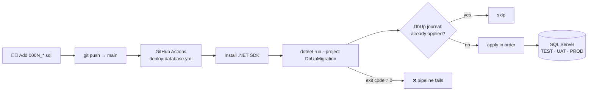

<div align="center">

# 🗄️ DbUp Pipeline

### Database changes as code: versioned SQL migrations deployed through GitHub Actions

*Write a numbered `.sql` file, push to `main`, and the pipeline applies it to the target SQL Server.*

<br/>


</div>

---

## 💡 Why

Running SQL scripts by hand against TEST, UAT and PROD causes drift, missed scripts and "works on my database" bugs. This project applies the **migrations-as-code** pattern to SQL Server:

- Every schema change is a **numbered, idempotent script** in source control.
- **[DbUp](https://dbup.readthedocs.io/)** tracks which scripts have already run (in its `SchemaVersions` journal) and applies only new ones, **in order**.
- **GitHub Actions** runs the migrator on every push to `main`. Connection strings come from **repository secrets** for each environment.

---

## 🧭 Flow



---

## 🧱 What's here

| Path | Purpose |
|---|---|
| `DbUpMigration/Program.cs` | C# console migrator. Takes the connection string as an argument, runs the scripts, prints coloured success/failure output, and **returns a non-zero exit code on failure** so CI stops |
| `DbUpMigration/Database/Migrations/0001_CreateOrdersTable.sql` | First migration. **Idempotent** (`IF NOT EXISTS`) creation of `Orders(OrderID PK, CustomerID)` |
| `.github/workflows/deploy-database.yml` | CD pipeline: checkout → .NET SDK → `dotnet run` with `secrets.TEST_SQL_CONNECTION` |
| `setup-project.sh` | Scaffolds the full folder layout: Database / SSIS / Scripts / workflows |
| `DatabasesCICD.sln` | Visual Studio solution |

### Environment promotion

Store one secret per environment and point a job at each:

```
TEST_SQL_CONNECTION   →  push to main
UAT_SQL_CONNECTION    →  manual approval / release branch
PROD_SQL_CONNECTION   →  protected environment with reviewers
```

---

## 🚀 Run locally

```bash
git clone https://github.com/nishantrv/DatabasesCICD.git
cd DatabasesCICD
dotnet run --project DbUpMigration -- "Server=localhost;Database=TestDB;Integrated Security=True;"
```

Add a change by creating the next numbered script, for example `0002_AddOrderDate.sql`, and pushing.

---

## 🗺️ Roadmap

- [x] DbUp console migrator with fail-fast exit codes
- [x] First idempotent migration
- [x] GitHub Actions deployment to TEST
- [ ] Load scripts relative to the project, and read the connection string from the `CONNECTION_STRING` env var in CI
- [ ] UAT / PROD jobs behind GitHub **environments** with required reviewers
- [ ] tSQLt unit tests (`Database/Tests/`)
- [ ] SSIS package deployment (`deploy-ssis.yml`, `Scripts/Deploy/Deploy-SSIS.sh`)

---

<div align="center">

Built by **[Nishant](https://github.com/nishantrv)**

</div>
